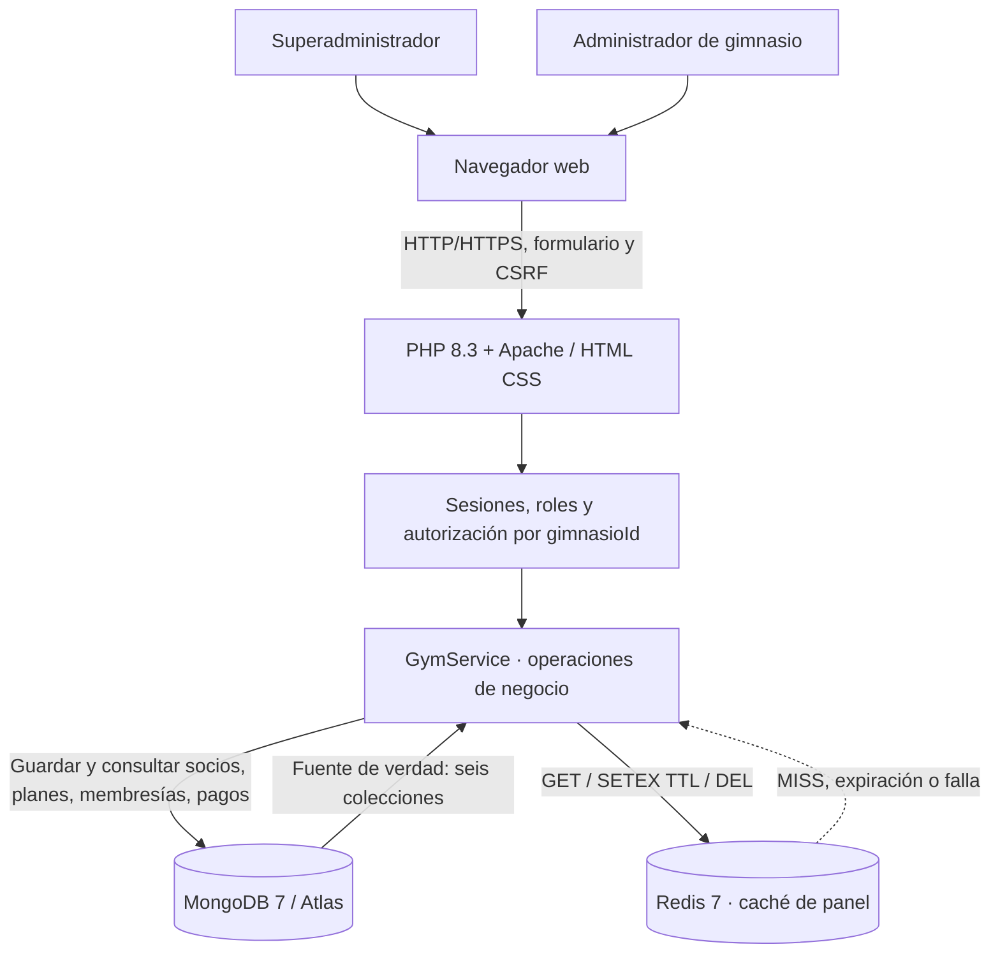

# Arquitectura v1 — GymFlow PHP + MongoDB + Redis

**Seguimiento 1 · Grupo 01 · 13 de octubre de 2026**

## Qué dato vive en cada motor y por qué

| Motor | Datos y función | Vida útil | Comportamiento si falla |
| --- | --- | --- | --- |
| **MongoDB** | Documentos **persistentes** `gimnasios`, `usuarios`, `socios`, `planes`, `membresias`, `pagos` con `ObjectId` y `Decimal128` | Persistentes en volumen o Atlas | El sistema **no declara guardada** una operación fallida; es dependencia esencial |
| **Redis** | Copia JSON **temporal**, separada por `gimnasioId`, de los indicadores del dashboard: socios, vigencias, pagos e ingresos | TTL configurable (60 s por defecto) | PHP calcula de nuevo desde MongoDB; no se pierden datos persistentes |

**Redis no contiene socios ni pagos como fuente de verdad. SQLite no se utiliza** por indicación del docente: no se requieren funciones offline. PHP genera las páginas web en servidor; no se necesita React, TypeScript ni Node.js.

## Flujo de lectura y escritura

1. El usuario autenticado abre `?page=dashboard`. `GymService` intenta leer `gymflow:s1:dashboard:<gimnasioId>` en Redis. Un **HIT** evita recomputar los indicadores; un **MISS** consulta MongoDB, calcula el resumen y ejecuta `SETEX` con tiempo de vida.
2. Un administrador registra o actualiza un socio, un plan o una membresía; o registra/anula un pago. **Primero** se confirma la escritura en MongoDB. **Después** se elimina `DEL` la clave Redis del gimnasio (invalidación).
3. Si Redis no responde, la aplicación usa MongoDB y sigue mostrando el panel; los fallos de Redis se registran en el log del servidor. Cada clave incorpora el `gimnasioId` autorizado por PHP, no un dato de sesión libremente editable en el navegador.
4. Un administrador de Hércules no puede consultar ni alterar datos de Titan. El superadministrador tiene autorización explícita para ambos.

## Topología y conectividad

- **Desarrollo local:** `http://localhost:8000` → contenedor PHP/Apache → servicios internos `mongo:27017` y `redis:6379` en Docker Compose. MongoDB conserva los documentos en `gymflow_mongo`. Redis es volátil; su caída no elimina datos de negocios. **Ninguno de los puertos de datos se publica al host**.
- **Atlas (opcional):** cambiar `MONGODB_URI` fuera del repositorio por la URI privada de Atlas AWS Oregon y autorizar la IP de salida del servidor. Redis puede seguir en Docker local (o usar otro servidor Redis seguro accesible por `REDIS_URL`).
- **Hosting en Virtualmin:** necesita PHP, extensión `mongodb`, dependencias Composer, Redis accesible y document root `public/`. Esta topología no se ha desplegado ni verificado todavía en el servidor académico.

## Decisiones y límites de S1

- Contraseñas con hash, cookies de sesión HttpOnly, tokens CSRF y validación de referencias entre gimnasios.
- El caché se delimita por `gimnasioId`; nunca se guardan contraseñas, tokens ni URIs en Redis. La consulta de listados detallados continúa en MongoDB.
- Los índices únicos evitan un segundo pago efectivo para la misma membresía. La protección total contra renovaciones concurrentes requerirá serializar altas o transacciones; queda como trabajo futuro.
- No incluye rutinas, máquinas, QR, agenda ni pago real integrado con banco.
- La medición de Redis frente a MongoDB puede reproducirse con `scripts/cache-benchmark.php`; anotar valores **reales**, nunca inventados.

Ver también [modelo de datos](../modelo-datos-v1.md), [pruebas](../PRUEBAS.md) y [bitácora](../seguimientos/S1.md).
