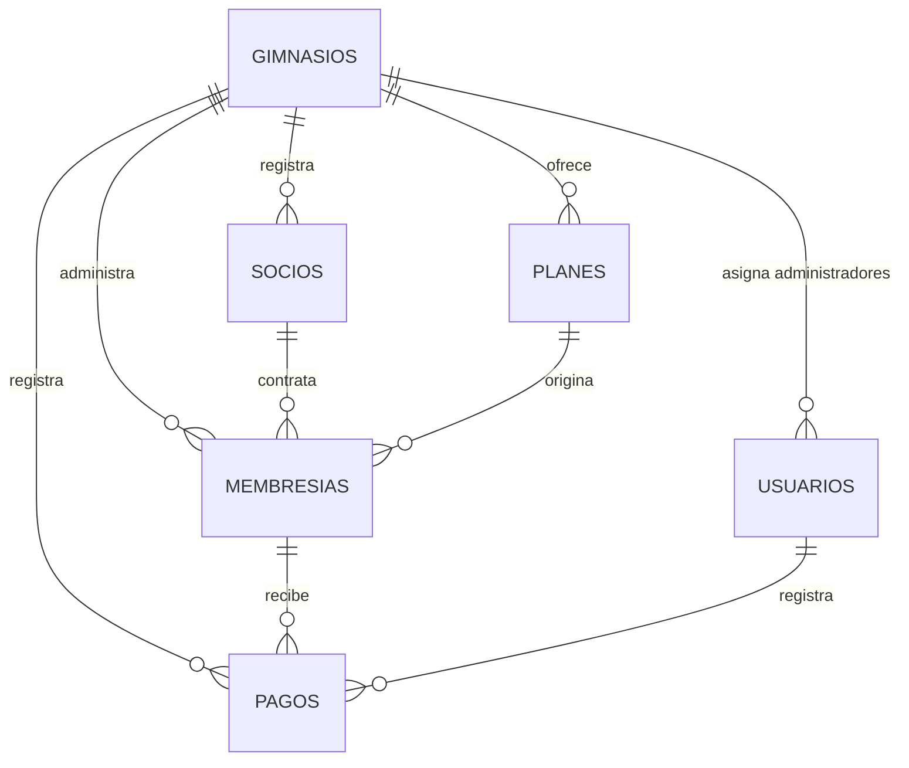

# Modelo de datos v1 de GymFlow

**Proyecto:** GymFlow SaaS — Gestión de gimnasios  
**Entregable:** Seguimiento 1  
**Versión:** 1.0 del diseño  
**Fecha:** 13 de octubre de 2026  
**Motor de datos:** MongoDB (local para pruebas o Atlas en despliegue)  
**Base de datos:** `gymflow`  
**Aplicación:** Aplicación web PHP (vistas HTML generadas desde PHP), accesible desde navegador y compatible con Virtualmin  
**Tipo de documento:** Diseño lógico de datos

## 1. Propósito y alcance

Este documento establece el modelo lógico de datos de GymFlow para el seguimiento 1. Define la estructura de las colecciones, los tipos de datos, las relaciones y las reglas que guían la implementación del sistema.

El alcance comprende gimnasios, usuarios administrativos, socios, planes, membresías y registro manual de pagos. Los indicadores del panel se calcularán a partir de estos datos. El modelo utiliza una base compartida con separación lógica por `gimnasioId`.

El alcance de esta versión comprende la gestión administrativa de múltiples gimnasios. Las máquinas, rutinas, agenda y acceso QR corresponden a funcionalidades de ampliación. Los socios se registran como clientes; las cuentas de acceso pertenecen al personal administrativo.

## 2. Colecciones y responsabilidades

| Colección | Responsabilidad |
| --- | --- |
| `gimnasios` | Identificar cada negocio y sus datos de contacto y ubicación. |
| `usuarios` | Identificar al personal autorizado y su rol de acceso. |
| `socios` | Guardar los datos del cliente de cada gimnasio. |
| `planes` | Definir las ofertas de membresía, duración y precio. |
| `membresias` | Registrar lo contratado por un socio durante un período. |
| `pagos` | Conservar el historial de cobros registrados para las membresías. |

## 3. Convenciones del modelo

- `_id`: identificador de documento de tipo `ObjectId`.
- Campos terminados en `Id` y `registradoPor`: referencias de tipo `ObjectId`.
- Fechas de eventos y membresías: tipo BSON `Date`, almacenadas en UTC y presentadas en `America/Costa_Rica`. El período de membresía comienza a las 00:00 de la fecha inicial local, inclusive, y finaliza a las 00:00 de la fecha final, exclusiva. La fecha final se obtiene sumando los días contratados a la fecha inicial. La fecha de nacimiento se conserva como cadena `YYYY-MM-DD`, sin componente horario.
- Importes: tipo `Decimal128`, sin símbolos monetarios ni separadores. La moneda es `CRC`. Los importes admiten dos decimales.
- Identificaciones, teléfonos y referencias de pago: cadenas, para conservar ceros y formatos.
- Un campo opcional puede omitirse. La excepción explícita es `usuarios.gimnasioId`, que podrá ser `null` para un superadministrador.
- Los estados y roles se restringen a los valores indicados en el diccionario. La validación de estructura se expresa mediante JSON Schema y las reglas entre documentos se aplican en el backend PHP.
- El campo `gimnasioId` se repite en las colecciones operativas para delimitar consultas. La API debe impedir que contradiga el gimnasio de los documentos referenciados.

## 4. Diccionario de datos

### 4.1. Colección `gimnasios`

Un documento representa un gimnasio registrado en la plataforma.

| Campo | Tipo BSON | Obligatorio | Descripción o regla |
| --- | --- | --- | --- |
| `_id` | ObjectId | Sí | Identificador del gimnasio. |
| `nombreComercial` | String | Sí | Nombre mostrado en la plataforma. |
| `razonSocial` | String | No | Razón social del negocio. |
| `contacto` | Object | Sí | Objeto embebido con los datos de contacto. |
| `contacto.correo` | String | Sí | Correo del gimnasio. |
| `contacto.telefono` | String | No | Teléfono de contacto. |
| `ubicacion` | Object | No | Objeto embebido con la ubicación. |
| `ubicacion.provincia` | String | No | Provincia. |
| `ubicacion.canton` | String | No | Cantón. |
| `estado` | String | Sí | `pendiente`, `activo` o `inactivo`. |
| `fechaRegistro` | Date | Sí | Fecha de creación del registro. |
| `observaciones` | String | No | Información complementaria del formulario. |

El nombre y correo del administrador capturados al registrar un gimnasio corresponden a un documento separado de `usuarios`. No se duplicará su contraseña en `gimnasios`.

### 4.2. Colección `usuarios`

Un documento representa una cuenta del personal con acceso al sistema.

| Campo | Tipo BSON | Obligatorio | Descripción o regla |
| --- | --- | --- | --- |
| `_id` | ObjectId | Sí | Identificador del usuario. |
| `gimnasioId` | ObjectId o Null | Sí | Referencia a `gimnasios._id`; nulo para `superadmin`. |
| `nombre` | String | Sí | Nombre del usuario. |
| `correo` | String | Sí | Correo único en toda la plataforma, sin espacios iniciales o finales y en minúsculas. |
| `passwordHash` | String | Sí | Hash de la contraseña; nunca contraseña en texto plano. |
| `rol` | String | Sí | `superadmin` o `administrador`. |
| `estado` | String | Sí | `activo` o `inactivo`. |

Cada administrador pertenece a un único gimnasio. El correo identifica una cuenta de forma única en toda la plataforma. El superadministrador tiene alcance global y gimnasioId nulo; el administrador requiere una referencia válida a su gimnasio.

### 4.3. Colección `socios`

Un documento representa a un cliente dentro de un gimnasio.

| Campo | Tipo BSON | Obligatorio | Descripción o regla |
| --- | --- | --- | --- |
| `_id` | ObjectId | Sí | Identificador del socio. |
| `gimnasioId` | ObjectId | Sí | Referencia a `gimnasios._id`. |
| `identificacion` | String | Sí | Identificación única dentro del gimnasio. |
| `nombreCompleto` | String | Sí | Nombre del cliente. |
| `contacto` | Object | No | Objeto embebido con correo y teléfono. |
| `contacto.correo` | String | No | Correo de contacto. |
| `contacto.telefono` | String | No | Teléfono de contacto. |
| `fechaNacimiento` | String | No | Fecha civil válida en formato `YYYY-MM-DD`, no posterior a la fecha actual. |
| `fechaRegistro` | Date | Sí | Fecha de registro del socio. |
| `estado` | String | Sí | `activo` o `inactivo`; no representa vigencia de membresía. |
| `observaciones` | String | No | Notas administrativas. |

Un socio puede tener varias membresías históricas. No se guardará el historial completo de membresías ni de pagos como arreglos dentro de este documento.

### 4.4. Colección `planes`

Un documento representa una oferta de membresía de un gimnasio.

| Campo | Tipo BSON | Obligatorio | Descripción o regla |
| --- | --- | --- | --- |
| `_id` | ObjectId | Sí | Identificador del plan. |
| `gimnasioId` | ObjectId | Sí | Referencia a `gimnasios._id`. |
| `nombre` | String | Sí | Nombre del plan. |
| `duracionDias` | Int | Sí | Duración positiva en días. |
| `precio` | Decimal128 | Sí | Precio mayor que cero. |
| `moneda` | String | Sí | `CRC` en esta versión. |
| `descripcion` | String | No | Beneficios y condiciones. |
| `estado` | String | Sí | `activo` o `inactivo`. |
| `observaciones` | String | No | Información administrativa complementaria. |

La duración del plan se expresa en días naturales completos. Un plan de 30 días suma exactamente 30 días a la fecha inicial, independientemente de la duración del mes calendario.

### 4.5. Colección `membresias`

Un documento representa la contratación de un plan por un socio durante un período.

| Campo | Tipo BSON | Obligatorio | Descripción o regla |
| --- | --- | --- | --- |
| `_id` | ObjectId | Sí | Identificador de la membresía. |
| `gimnasioId` | ObjectId | Sí | Referencia a `gimnasios._id`. |
| `socioId` | ObjectId | Sí | Referencia a `socios._id`. |
| `planId` | ObjectId | Sí | Referencia a `planes._id`. |
| `condicionesContratadas` | Object | Sí | Copia histórica de las condiciones al contratar. |
| `condicionesContratadas.nombrePlan` | String | Sí | Nombre del plan al contratar. |
| `condicionesContratadas.duracionDias` | Int | Sí | Duración acordada, positiva. |
| `condicionesContratadas.precio` | Decimal128 | Sí | Precio acordado, mayor que cero. |
| `condicionesContratadas.moneda` | String | Sí | Moneda acordada, `CRC`. |
| `fechaInicio` | Date | Sí | Inicio del período contratado. |
| `fechaFin` | Date | Sí | Fin del período, posterior al inicio. |
| `cancelada` | Boolean | Sí | Indica cancelación administrativa; inicialmente `false`. |
| `fechaCreacion` | Date | Sí | Momento de creación del documento. |
| `observaciones` | String | No | Notas del registro. |

Cada renovación creará una nueva membresía. Se conservará `planId` como referencia, pero las condiciones contratadas no se modificarán cuando cambie el catálogo de planes.

La vigencia temporal se deriva de las fechas y la cancelación. El estado de pago se calcula a partir de los pagos registrados, sin duplicar un saldo en la membresía. Para habilitar el servicio deben cumplirse ambas condiciones: período vigente y pago completo.

| Condición | Clasificación |
| --- | --- |
| `cancelada = true` | Cancelada; no habilita el servicio. |
| Fecha actual anterior a `fechaInicio` | Futura. |
| `fechaInicio <= fecha actual < fechaFin` | Vigente en términos temporales. |
| Fecha actual igual o posterior a `fechaFin` | Vencida. |
| Vigente y con un máximo de 7 días hasta `fechaFin` | Próxima a vencer. |
| Sin pago registrado válido | No pagada; no habilita el servicio aunque el período sea vigente. |

La renovación genera una nueva membresía. Si existe un período no cancelado vigente o futuro, comienza al finalizar el último período; si no existe, comienza en la fecha de inicio seleccionada. No se admiten períodos superpuestos no cancelados para el mismo socio y gimnasio. Las membresías canceladas conservan fechas y condiciones históricas.

### 4.6. Colección `pagos`

Un documento representa un cobro registrado manualmente para una membresía.

| Campo | Tipo BSON | Obligatorio | Descripción o regla |
| --- | --- | --- | --- |
| `_id` | ObjectId | Sí | Identificador del pago. |
| `gimnasioId` | ObjectId | Sí | Referencia a `gimnasios._id`. |
| `membresiaId` | ObjectId | Sí | Referencia a `membresias._id`. |
| `fechaPago` | Date | Sí | Fecha del pago. |
| `monto` | Decimal128 | Sí | Monto mayor que cero. |
| `moneda` | String | Sí | Debe coincidir con la moneda de la membresía. |
| `metodo` | String | Sí | `sinpe_movil`, `efectivo` o `transferencia`. |
| `referencia` | String | No | Referencia del comprobante externo. |
| `claveOperacion` | String | Sí | UUID de la operación, único por gimnasio; se conserva al reintentar el registro. |
| `registradoPor` | ObjectId | Sí | Referencia a `usuarios._id`. |
| `estado` | String | Sí | `registrado` o `anulado`. |
| `anulacion` | Object | Condicional | Obligatorio cuando el estado es `anulado`. |
| `anulacion.fecha` | Date | Condicional | Fecha de la anulación. |
| `anulacion.usuarioId` | ObjectId | Condicional | Usuario autorizado que anula. |
| `anulacion.motivo` | String | Condicional | Justificación no vacía de la anulación. |
| `observaciones` | String | No | Notas del pago. |

En esta versión, cada pago cubre el precio completo de una membresía y su monto debe coincidir con condicionesContratadas.precio. No se admiten abonos ni sobrepagos. Una membresía admite varios documentos históricos de pago, pero solo uno con estado registrado; los restantes deben estar anulados.

El socio se obtiene a través de la membresía, evitando repetir su nombre y su identificador en cada pago. El formulario puede seleccionar primero al socio y luego una de sus membresías. Registrar SINPE Móvil como método no implica conexión con un banco.

## 5. Relaciones lógicas

El diagrama representa las asociaciones entre documentos mediante referencias ObjectId. La integridad de estas asociaciones se controla desde el backend PHP.

La relación gimnasio–usuario aplica a los administradores. El superadministrador es la excepción, con alcance global y `gimnasioId: null`.

| Referencia | Documento de destino | Comprobación necesaria |
| --- | --- | --- |
| `gimnasioId` | `gimnasios._id` | El gimnasio existe y el usuario tiene acceso autorizado. |
| `membresias.socioId` | `socios._id` | El socio pertenece al gimnasio de la membresía. |
| `membresias.planId` | `planes._id` | El plan pertenece al mismo gimnasio y está disponible para contratar. |
| `pagos.membresiaId` | `membresias._id` | La membresía pertenece al gimnasio del pago. |
| `pagos.registradoPor` | `usuarios._id` | El usuario está autorizado para registrar el pago. |
| `pagos.anulacion.usuarioId` | `usuarios._id` | El usuario está autorizado para anular en ese gimnasio. |

## 6. Datos embebidos y referencias

| Elemento | Decisión | Justificación |
| --- | --- | --- |
| Contacto del gimnasio y del socio | Embebido | Es pequeño y se consulta con su propietario. |
| Ubicación del gimnasio | Embebida | Forma parte del perfil del negocio. |
| Condiciones contratadas | Embebidas en la membresía | Conservan precio, nombre y duración históricos sin depender de cambios posteriores del plan. |
| Socio y plan de una membresía | Referencias | Tienen identidad propia y se utilizan en múltiples operaciones. |
| Pagos de una membresía | Colección separada | Permite historial y reportes por fecha sin arreglos de crecimiento indefinido. |
| Usuario que registra un pago | Referencia | Permite identificar al responsable sin duplicar sus datos. |

## 7. Separación por gimnasio y reglas de integridad

1. La API obtendrá la identidad y el gimnasio autorizado desde la autenticación. No confiará únicamente en un `gimnasioId` enviado por el navegador.
2. Las lecturas y escrituras del administrador se limitarán a su gimnasio. Las operaciones globales del superadministrador tendrán autorización explícita en el servidor.
3. La API verificará que todas las referencias utilizadas en una operación correspondan al mismo gimnasio.
4. Los socios, planes y usuarios con historial se desactivan en lugar de eliminarse físicamente. Las membresías canceladas y pagos anulados se conservarán para trazabilidad.
5. Los cambios de precio del catálogo no alterarán membresías ya contratadas.
6. Anular un pago cambia su estado a anulado y registra usuario, fecha y motivo. Ese pago deja de computar como cobro válido, por lo que la membresía queda no pagada hasta registrar un pago de reemplazo. La anulación es administrativa y no ejecuta una devolución bancaria.
7. La aplicación confirmará una operación solo después de comprobar su guardado. Si MongoDB no responde, mostrará el error y no afirmará que el registro se completó.
8. Registrar un pago no modifica las fechas ni copia un estado de pago en la membresía. El pago se consulta desde su propia colección. La claveOperacion única evita duplicar la misma solicitud por reintentos; el índice único parcial limita a un pago registrado por membresía. Los intentos de duplicación devuelven el resultado existente o un conflicto, según corresponda.

## 8. Consultas e índices del modelo

Los índices se definen para asegurar unicidad y apoyar las consultas operativas por gimnasio. Su creación forma parte de la implementación del modelo.

| Colección | Campos del índice | Único | Uso previsto |
| --- | --- | --- | --- |
| `usuarios` | `{ correo: 1 }` | Sí | Identificar de forma única cada cuenta. |
| `pagos` | `{ gimnasioId: 1, claveOperacion: 1 }` | Sí | Evitar duplicación por reintentos de una operación. |
| `socios` | `{ gimnasioId: 1, identificacion: 1 }` | Sí | Evitar identificaciones duplicadas dentro del mismo gimnasio. |
| `planes` | `{ gimnasioId: 1, estado: 1 }` | No | Listar planes disponibles de un gimnasio. |
| `membresias` | `{ gimnasioId: 1, socioId: 1 }` | No | Consultar el historial de un socio. |
| `membresias` | `{ gimnasioId: 1, fechaFin: 1 }` | No | Consultar vencimientos dentro de un período. |
| `pagos` | `{ gimnasioId: 1, fechaPago: 1 }` | No | Consultar pagos e ingresos por gimnasio y rango de fechas. |
| `pagos` | `{ gimnasioId: 1, membresiaId: 1 }` | No | Consultar los pagos de una membresía. |

Además, se define un índice único parcial en pagos sobre `{ gimnasioId: 1, membresiaId: 1 }`, con filtro `{ estado: "registrado" }`. El índice no único sobre esos mismos campos atiende el historial completo, incluidos pagos anulados. El índice parcial garantiza un solo pago efectivo por membresía. La normalización del correo precede a la validación de su unicidad.

El control de superposición de períodos se realiza en la API; el índice del historial de membresías no constituye por sí mismo una restricción de fechas. Las operaciones de alta y renovación para un mismo socio se serializan para evitar altas concurrentes de períodos superpuestos.

## 9. Datos de prueba y reportes

Se utilizarán datos sintéticos reproducibles. El conjunto de prueba comprende dos gimnasios de demostración, un superadministrador, un administrador por gimnasio, varios socios y planes, y membresías futuras, vigentes, próximas a vencer, vencidas y canceladas. También se incluirán pagos registrados y anulados.

Los ejemplos deberán permitir comprobar que un administrador no puede consultar ni modificar el gimnasio de otro. No se utilizarán datos personales reales ni contraseñas o cadenas de conexión reales dentro del repositorio.

Los reportes se calcularán desde los documentos: socios por gimnasio, membresías según vigencia e ingresos por período a partir de pagos registrados, excluyendo anulados. El indicador de socios activos cuenta socios distintos con estado activo y al menos una membresía habilitada por fecha, pago y ausencia de cancelación. Los indicadores de membresías cuentan documentos de membresía según su clasificación. Los ingresos suman montos de pagos registrados, filtrados por fechaPago y gimnasioId.

## 10. Arquitectura de persistencia

La interfaz web se genera en el servidor utilizando PHP y HTML/CSS, sin frontend React ni Node.js. PHP se conecta a la base gymflow mediante la extensión y la biblioteca MongoDB para PHP. MongoDB Atlas centraliza la persistencia de las seis colecciones.

El despliegue de Atlas se establece en AWS Oregon y restringe el acceso a la IP del servidor, conforme al enunciado. Las credenciales y la URI se administran fuera del repositorio y del contenido público del sitio. El navegador envía formularios HTTP al servidor PHP mediante sesiones; no recibe credenciales ni accede directamente a Atlas.

## 11. Criterios de validación del modelo

- Cada colección tiene campos obligatorios y tipos BSON definidos.
- Los administradores se asocian a un gimnasio y los superadministradores tienen alcance global.
- Los socios se identifican de forma única dentro de cada gimnasio.
- Los importes son positivos, se expresan en CRC y utilizan Decimal128.
- Las fechas de inicio y fin delimitan un período válido y no superpuesto para el socio.
- Las condiciones históricas de contratación se conservan aunque cambie el plan.
- Los pagos efectivos coinciden con el precio contratado y no se duplican por reintentos.
- Los documentos relacionados pertenecen al gimnasio autorizado.
- Los historiales se preservan mediante desactivación, cancelación y anulación.
- Los datos embebidos contienen información acotada; los historiales se mantienen en colecciones referenciadas.

## 12. Material de referencia

- **Proyecto Final Open Source — Enunciado y Seguimientos**: requisitos del seguimiento 1, tareas de MongoDB y perfiles tecnológicos.
- **01_Gym_SaaS_Gestion_de_Gimnasios(1).pptx**: propuesta y fases del producto.

Este modelo constituye la especificación de datos v1 para el seguimiento 1 y orienta la implementación de GymFlow.

## Complemento de arquitectura S1 · Redis (13/10/2026)

**Aclaración:** este documento describe las **seis colecciones persistentes en MongoDB**; Redis es el **segundo motor** del proyecto, seleccionado para una función distinta. Redis **no añade colecciones de negocio** ni altera el modelo BSON.

- Clave de caché por gimnasio: `gymflow:s1:dashboard:<gimnasioId>`.
- Valor temporal: JSON con contadores de socios, membresías e ingresos calculados sobre MongoDB. TTL 60 segundos por defecto.
- Lectura: HIT retorna ese JSON; MISS consulta MongoDB y reconstruye el valor en Redis.
- Escritura confirmada en MongoDB: se invalida la clave del gimnasio mediante `DEL`.
- Caída o expiración de Redis: se vuelve a calcular desde MongoDB sin perder datos.
- SQLite no se emplea por la indicación del profesor.

Consultar [arquitectura de dos motores](arquitectura/arquitectura-v1.md) para el diagrama de las conexiones.
