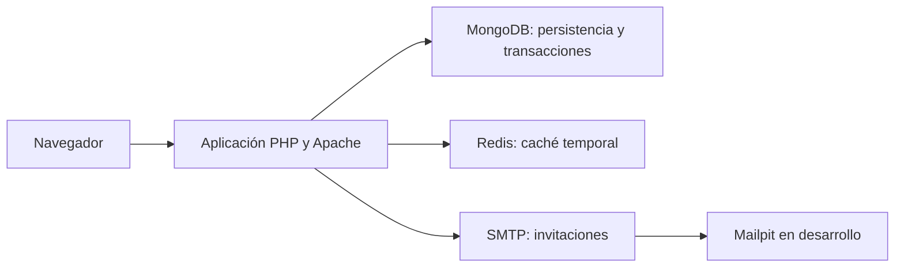
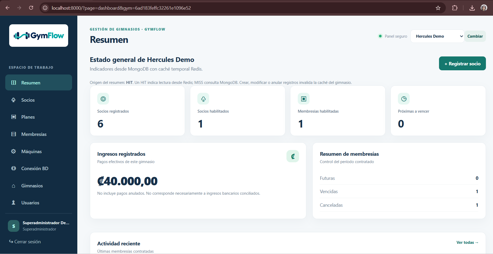
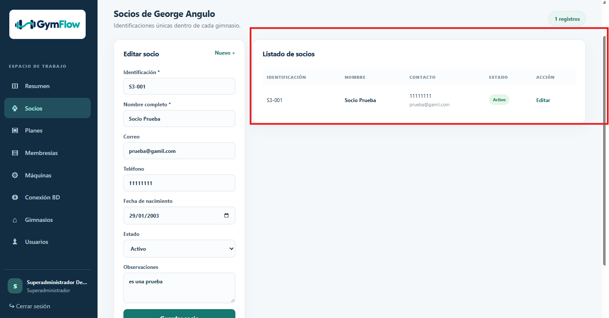
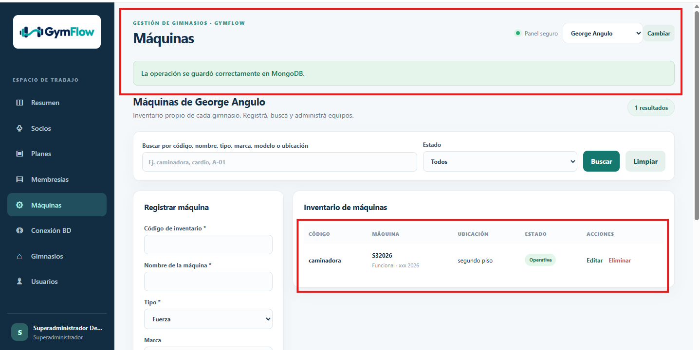
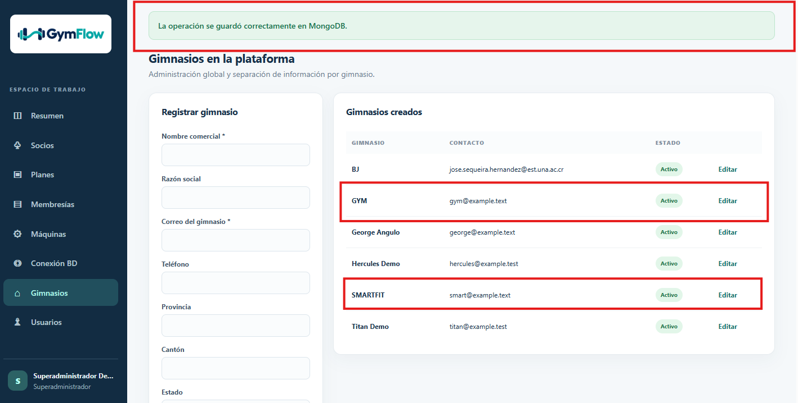

# GymFlow · Gestión de gimnasios · Grupo 01

Proyecto Final Open Source · Tópicos Avanzados de Bases de Datos · Universidad Nacional.

GymFlow es una aplicación web de código abierto que centraliza la administración de gimnasios, socios, planes, membresías, pagos manuales e inventario de máquinas. Está desarrollada con PHP y utiliza MongoDB para la persistencia de información y Redis para la caché temporal del resumen de cada gimnasio.

## Enlaces del proyecto

- **Repositorio:** [DixonBM/GymFlow-grupo01](https://github.com/DixonBM/GymFlow-grupo01)
- **Aplicación desplegada:** [GymFlow](https://grupo1.crnube.org/gymflow/)
- **Video de demostración:** [Ver demostración de GymFlow](https://youtu.be/l7KlEOZn9FA)
- **Tablero de trabajo:** [GitHub Projects](https://github.com/users/DixonBM/projects/3)
- **Hitos:** [Milestones](https://github.com/DixonBM/GymFlow-grupo01/milestones)
- **Versiones publicadas:** [Releases](https://github.com/DixonBM/GymFlow-grupo01/releases)
- **Historial de cambios:** [CHANGELOG.md](CHANGELOG.md)
- **Ficha del proyecto:** [portal.yml](portal.yml)

La aplicación desplegada requiere acceso autorizado al servidor y una cuenta del sistema. Para ejecutar una demostración propia se puede utilizar la instalación local descrita en este documento.

## Contenido

1. [Descripción y problema](#descripción-y-problema)
2. [Usuarios y permisos](#usuarios-y-permisos)
3. [Funcionalidades](#funcionalidades)
4. [Reglas de negocio](#reglas-de-negocio)
5. [Tecnologías y arquitectura](#tecnologías-y-arquitectura)
6. [Modelo de almacenamiento](#modelo-de-almacenamiento)
7. [Instalación local con Docker](#instalación-local-con-docker)
8. [Uso de la aplicación](#uso-de-la-aplicación)
9. [Variables de entorno](#variables-de-entorno)
10. [Instalación manual](#instalación-manual)
11. [Pruebas y validación](#pruebas-y-validación)
12. [Instalación desde cero y evidencias](#instalación-desde-cero-y-evidencias)
13. [Mediciones de rendimiento](#mediciones-de-rendimiento)
14. [Despliegue](#despliegue)
15. [Capturas](#capturas)
16. [Estructura del repositorio](#estructura-del-repositorio)
17. [Documentación](#documentación)
18. [Solución de problemas](#solución-de-problemas)
19. [Versiones y evolución futura](#versiones-y-evolución-futura)
20. [Equipo y licencia](#equipo-y-licencia)

## Descripción y problema

Los gimnasios pequeños suelen administrar socios, vencimientos, planes y cobros mediante hojas de cálculo, documentos separados o registros manuales. Esto dificulta consultar información actualizada, conservar el historial y controlar el acceso a los datos.

GymFlow reúne estas operaciones en una aplicación web y permite trabajar con varios gimnasios sin mezclar su información operativa.

Sus objetivos son:

- Centralizar los datos administrativos del gimnasio.
- Facilitar el seguimiento de socios, membresías y pagos.
- Conservar las condiciones contratadas y el historial de operaciones.
- Separar la información según el gimnasio del administrador.
- Integrar dos motores de datos con responsabilidades distintas.
- Ofrecer una instalación reproducible y herramientas de comprobación.

## Usuarios y permisos

| Usuario | Responsabilidades |
| --- | --- |
| Superadministrador | Administra gimnasios y usuarios administrativos. Puede seleccionar el gimnasio cuya información desea gestionar. |
| Administrador de gimnasio | Gestiona los socios, planes, membresías, pagos y máquinas de su gimnasio. |
| Socio | Cliente registrado por el administrador. No tiene una cuenta propia de acceso en esta versión. |

La aplicación determina el gimnasio de un administrador a partir de su cuenta. La separación de información no depende únicamente de ocultar opciones en la interfaz: los servicios restringen las operaciones al gimnasio correspondiente.

Los módulos globales de gimnasios y usuarios administrativos están reservados al superadministrador.

## Funcionalidades

### Autenticación y usuarios

- Inicio y cierre de sesión.
- Validación de credenciales.
- Control de acceso por rol.
- Administración de cuentas.
- Activación de nuevas cuentas mediante invitaciones por correo.
- Reenvío de invitaciones.
- Gestión de usuarios activos, inactivos y pendientes de activación.

### Gimnasios

- Registro de gimnasios.
- Modificación de información comercial y de contacto.
- Administración de su estado.
- Selección de gimnasio por parte del superadministrador.

### Socios

- Registro de socios.
- Consulta y modificación de sus datos.
- Activación y desactivación.
- Identificación única dentro de cada gimnasio.
- Separación de los registros por gimnasio.

### Planes

- Registro y modificación de planes.
- Configuración de duración y precio.
- Activación y desactivación.
- Manejo de importes en colones costarricenses.

### Membresías

- Contratación de planes para un socio.
- Conservación de las condiciones contratadas.
- Registro de fechas de inicio y finalización.
- Cancelación con conservación del historial.
- Renovación con registro integrado del pago.
- Validación de períodos superpuestos.

### Pagos

- Registro manual de pagos en efectivo, SINPE Móvil y transferencia.
- Conservación del método, referencia y responsable.
- Control de un único pago efectivo por membresía.
- Anulación con motivo.
- Consulta del historial.

Los pagos representan operaciones realizadas fuera de GymFlow. El sistema no se conecta a bancos ni ejecuta transferencias o cobros automáticos.

### Máquinas

- Registro de máquinas por gimnasio.
- Edición y eliminación.
- Búsqueda y filtros por estado.
- Código único por gimnasio.
- Clasificación por tipo.
- Estados operativa, mantenimiento y fuera de servicio.

### Resumen y conexión

- Indicadores administrativos por gimnasio.
- Caché temporal del resumen mediante Redis.
- Identificación de lecturas de caché mediante estados HIT/MISS.
- Pantalla de conexión a MongoDB y Redis.
- Consulta del resumen desde MongoDB cuando Redis no está disponible.

## Reglas de negocio

- Los administradores operan únicamente sobre su gimnasio.
- La identificación de un socio es única dentro del gimnasio.
- El código de una máquina es único dentro del gimnasio.
- Los planes requieren duración y precio positivos.
- Una membresía conserva las condiciones del plan al momento de contratar.
- La modificación posterior de un plan no debe alterar las condiciones históricas contratadas.
- La cancelación de una membresía conserva su historial.
- La renovación se realiza sobre una membresía elegible y valida los períodos.
- La renovación y su pago se registran dentro de una misma transacción MongoDB.
- Los pagos utilizan el precio contratado.
- La anulación de un pago requiere un motivo.
- Las invitaciones de activación vencen en 24 horas y tienen un solo uso.
- El reenvío de una invitación requiere esperar un minuto desde el envío anterior.

## Tecnologías y arquitectura

| Componente | Tecnología | Responsabilidad |
| --- | --- | --- |
| Aplicación web | PHP y HTML/CSS | Interfaz, formularios, sesiones, permisos y reglas de negocio. |
| Servidor local Docker | PHP 8.3 + Apache | Ejecución de la aplicación. |
| Persistencia | MongoDB 7 | Almacenamiento definitivo y transacciones. |
| Caché | Redis 7.4 | Almacenamiento temporal del resumen por gimnasio. |
| Cliente Redis | Predis | Comunicación entre PHP y Redis. |
| Correo | PHPMailer y SMTP | Envío de invitaciones. |
| Correo de desarrollo | Mailpit | Captura local de mensajes sin entrega externa. |
| Dependencias | Composer | Instalación de bibliotecas PHP mediante el archivo lock. |
| Entorno local | Docker Compose | Coordinación de aplicación, MongoDB, Redis y Mailpit. |
| Integración continua | GitHub Actions | Validación de sintaxis PHP y prueba de caché. |



La aplicación no requiere React ni Node.js para ejecutarse.

La arquitectura detallada se encuentra en [docs/arquitectura/arquitectura-v1.md](docs/arquitectura/arquitectura-v1.md).

## Modelo de almacenamiento

### MongoDB

MongoDB conserva la información definitiva en siete colecciones:

| Colección | Información |
| --- | --- |
| `gimnasios` | Datos comerciales, contacto y estado de los gimnasios. |
| `usuarios` | Cuentas administrativas, roles, contraseñas protegidas e invitaciones. |
| `socios` | Clientes de cada gimnasio. |
| `planes` | Duración, precio y estado de los planes. |
| `membresias` | Contrataciones, condiciones acordadas, fechas e historial. |
| `pagos` | Pagos manuales y anulaciones. |
| `maquinas` | Inventario de máquinas por gimnasio. |

El setup configura validadores e índices. Entre ellos se encuentran:

- Correo único de usuario.
- Identificación única de socio por gimnasio.
- Código único de máquina por gimnasio.
- Índices para consultas de planes, membresías y pagos.
- Control de operaciones de pago y de un pago efectivo por membresía.
- Índice del token de invitación mediante su migración.

Los importes se representan con `Decimal128`.

La renovación con pago requiere un replica set o un clúster compatible con transacciones. Docker configura el replica set local `rs0`.

El modelo inicial está documentado en [docs/modelo-datos-v1.md](docs/modelo-datos-v1.md); los servicios y migraciones reflejan las ampliaciones posteriores.

### Redis

Redis almacena temporalmente el resumen de cada gimnasio.

- Clave: `gymflow:s1:dashboard:<gimnasioId>`.
- Contenido: resumen serializado como JSON.
- TTL predeterminado: 60 segundos.
- Rango configurable: entre 1 y 3600 segundos.
- Operaciones utilizadas: `GET`, `SETEX`, `DEL` y `PING`.
- Invalidación después de escrituras que afectan los indicadores.
- Recuperación del resumen desde MongoDB cuando no hay caché o Redis falla.

Redis no conserva la única copia de socios, membresías o pagos. En Docker se configura como una caché sin persistencia.

## Instalación local con Docker

### Requisitos

- Git.
- Docker Desktop iniciado y configurado para contenedores Linux.
- Docker Compose v2 actualizado.
- Acceso a Internet para descargar imágenes y dependencias.
- Puertos locales 8000 y 8025 disponibles.
- VS Code u otro editor, opcional.

Para esta instalación no hace falta instalar PHP, Composer, MongoDB ni Redis directamente en Windows.

Los ejemplos siguientes utilizan PowerShell.

### 1. Comprobar las herramientas

```powershell
git --version
docker version
docker compose version
```

`docker version` debe mostrar información del cliente y del servidor.

Si no se conecta al servidor, abrir Docker Desktop y esperar a que termine de iniciar.

### 2. Clonar el repositorio

Desde una carpeta donde todavía no exista una copia con el mismo nombre:

```powershell
git clone https://github.com/DixonBM/GymFlow-grupo01.git
Set-Location .\GymFlow-grupo01
git rev-parse HEAD
```

El último comando permite identificar la revisión instalada.

### 3. Usar la configuración local predeterminada

**No crear ni copiar `.env` para la configuración Docker predeterminada.**

Compose establece automáticamente las direcciones internas de MongoDB, Redis y Mailpit.

El archivo `.env.example` contiene valores que deben adaptarse según el entorno. Copiarlo sin modificar puede reemplazar los nombres internos de Docker por direcciones incorrectas.

Las variables definidas en la terminal también pueden sobrescribir los valores de Compose.

### 4. Construir e iniciar

```powershell
docker compose up --build -d --wait --wait-timeout 240
docker compose ps
```

La primera construcción descarga imágenes e instala dependencias, por lo que puede tardar varios minutos.

Al finalizar:

- `app` debe estar iniciado.
- `mailpit` debe estar iniciado.
- `mongo` debe estar saludable.
- `redis` debe estar saludable.

MongoDB inicia automáticamente el replica set `rs0`.

Si Compose no reconoce `--wait` o `--wait-timeout`, actualizar Docker Desktop/Compose.

### 5. Crear esquemas, índices y datos sintéticos

```powershell
docker compose exec app php scripts/setup.php --seed
docker compose exec app php scripts/migrate-invitaciones.php
```

El setup crea o verifica las siete colecciones.

En una base vacía, el seed genera:

- Dos gimnasios.
- Tres cuentas administrativas.
- Diez socios.
- Cuatro planes.
- Diez membresías.
- Seis pagos, incluidos pagos anulados para pruebas.

Las fechas de las membresías sintéticas se calculan respecto al día de ejecución.

La colección de máquinas inicialmente queda vacía. Su funcionamiento se prueba registrando una máquina desde la interfaz.

La migración de invitaciones verifica el estado pendiente de los usuarios y agrega el índice del token.

### 6. Guardar las credenciales de prueba

El seed imprime contraseñas aleatorias al crear las cuentas.

| Cuenta | Acceso |
| --- | --- |
| `superadmin@gymflow.test` | Superadministrador |
| `hercules@gymflow.test` | Administrador de Hércules Demo |
| `titan@gymflow.test` | Administrador de Titan Demo |

Guardar las contraseñas en privado. No publicarlas en capturas, commits o comentarios.

Repetir el seed conserva las cuentas existentes y sus contraseñas; no vuelve a imprimir las claves originales.

### 7. Comprobar los motores y la caché

```powershell
docker compose exec app php scripts/smoke.php
docker compose exec app php scripts/unit-cache.php
docker compose exec mongo mongosh --quiet --eval 'db.hello().isWritablePrimary'
```

El smoke debe finalizar con:

```text
OK: MongoDB+Redis PING, seis colecciones, datos, indices, aislamiento y cache MISS/HIT.
```

El mensaje menciona seis porque comprueba las seis colecciones originales. El sistema ya contiene siete colecciones; máquinas, invitaciones y renovación se verifican adicionalmente en la interfaz.

La prueba unitaria debe finalizar con:

```text
OK: Redis simulado MISS / HIT / invalida / falla sin lanzar excepciones.
```

Los errores de conexión simulados en esa prueba son intencionales.

La consulta de MongoDB debe devolver:

```text
true
```

### 8. Abrir la aplicación

- Aplicación: http://localhost:8000
- Bandeja de Mailpit: http://localhost:8025

Ingresar con una cuenta del seed y su contraseña privada.

### 9. Detener y volver a iniciar

Para detener conservando los datos de MongoDB:

```powershell
docker compose down
```

Para iniciar la misma instalación nuevamente:

```powershell
docker compose up -d --wait --wait-timeout 240
```

MongoDB conserva sus datos en el volumen. Redis puede iniciar vacío y reconstruir su caché. Mailpit no tiene almacenamiento persistente configurado.

## Uso de la aplicación

### Seleccionar el gimnasio

El superadministrador utiliza el selector de gimnasio para consultar sus datos.

Un administrador trabaja con el gimnasio asignado a su cuenta.

### Registrar un socio y un plan

1. Abrir **Socios**.
2. Registrar una persona ficticia con identificación nueva.
3. Abrir **Planes**.
4. Crear un plan con duración y precio positivos.
5. Confirmar que ambos registros aparecen en sus listados.

### Contratar una membresía y registrar un pago

1. Abrir **Membresías**.
2. Seleccionar el socio y el plan.
3. Indicar una fecha inicial válida.
4. Confirmar la contratación.
5. Entrar a **Membresías → Ver pagos de membresías**.
6. Seleccionar la membresía sin pago.
7. Elegir el método y registrar la referencia correspondiente.
8. Confirmar y comprobar el historial después de recargar.

### Renovar con pago integrado

1. Abrir **Membresías**.
2. Buscar la membresía elegible más reciente del socio.
3. Pulsar **Renovar**.
4. Revisar el plan, las fechas y los datos del pago.
5. Confirmar la renovación y el pago.
6. Comprobar la nueva membresía y su pago, conservando el historial anterior.

Este flujo utiliza una transacción MongoDB. Una instancia standalone no satisface el requisito transaccional.

### Administrar máquinas

1. Abrir **Máquinas**.
2. Registrar una máquina con código nuevo.
3. Seleccionar tipo y estado.
4. Guardar y comprobar su aparición en el listado.
5. Probar búsqueda, filtros y edición.

### Crear y activar un usuario

1. Ingresar como superadministrador.
2. Abrir **Usuarios**.
3. Crear una cuenta con correo nuevo y gimnasio activo asignado.
4. Abrir Mailpit en http://localhost:8025.
5. Consultar la invitación.
6. Abrir el enlace en una ventana privada sin una sesión previa.
7. Definir una contraseña de al menos 12 caracteres.
8. Comprobar el ingreso con la cuenta activada.

Mailpit captura los mensajes localmente; no los entrega a buzones externos.

No publicar enlaces de activación: contienen un token de un solo uso.

### Consultar conexión y caché

- **Conexión BD** muestra el estado de MongoDB y Redis.
- **Resumen** presenta los indicadores del gimnasio.
- Visitar el resumen dos veces seguidas permite observar la caché.
- El smoke fuerza una lectura MISS seguida de una lectura HIT para comprobar ambos caminos.

## Variables de entorno

Valores predeterminados de Docker Compose:

| Variable | Valor local o función |
| --- | --- |
| `MONGODB_URI` | `mongodb://mongo:27017/?replicaSet=rs0` |
| `MONGODB_DB` | `gymflow` |
| `REDIS_URL` | `redis://redis:6379` |
| `CACHE_TTL_SECONDS` | `60`, configurable entre 1 y 3600 |
| `APP_ENV` | `local` |
| `APP_URL` | `http://localhost:8000/` |
| `SMTP_HOST` | `mailpit` |
| `SMTP_PORT` | `1025` |
| `SMTP_AUTH` | `false` |
| `SMTP_ENCRYPTION` | `none` para Mailpit local |
| `SMTP_USER` | Vacío en Mailpit; privado con un proveedor real |
| `SMTP_PASS` | Vacío en Mailpit; privado con un proveedor real |
| `MAIL_FROM` | `no-reply@gymflow.test` |
| `MAIL_FROM_NAME` | `GymFlow` |

`APP_URL` se utiliza para construir los enlaces de activación.

El SMTP sin cifrado está permitido únicamente con `APP_ENV=local`. Un proveedor real debe configurarse con `starttls` o `tls`, según sus requisitos.

No publicar `.env`, contraseñas, cookies ni cadenas de conexión con credenciales.

## Instalación manual

Esta alternativa requiere:

- PHP 8.2 o superior.
- Extensión PHP `mongodb` 2.x.
- Composer 2.
- MongoDB configurado como replica set o un clúster Atlas compatible.
- Redis accesible.
- SMTP accesible desde el proceso PHP.

Predis no requiere instalar la extensión `phpredis`.

### Preparar configuración

En una copia del repositorio:

```powershell
Copy-Item .env.example .env
```

Editar `.env` para los servicios de esa computadora:

- MongoDB debe apuntar a una instancia compatible con transacciones.
- Redis debe apuntar al servicio real.
- `APP_URL` debe coincidir con la dirección utilizada en el navegador.
- SMTP debe ser accesible desde PHP.

Los nombres `mongo`, `redis` y `mailpit` corresponden a la red interna de Compose.

El Mailpit incluido publica su bandeja web en 8025, pero no publica el puerto SMTP 1025 al host. Para utilizarlo desde PHP fuera de Docker se necesita configurar esa publicación local o utilizar otro SMTP accesible.

### Instalar e iniciar

```powershell
composer install
php scripts/setup.php --seed
php scripts/migrate-invitaciones.php
php scripts/smoke.php
php scripts/unit-cache.php
php -S 127.0.0.1:8000 -t public public/router.php
```

El servidor integrado de PHP se utiliza para desarrollo.

## Pruebas y validación

### Prueba de integración básica

```powershell
docker compose exec app php scripts/smoke.php
```

Comprueba:

- Conexión real con MongoDB.
- Conexión real con Redis.
- Datos en las seis colecciones originales.
- Existencia del índice parcial de pagos.
- Separación de socios por gimnasio.
- Lectura MISS seguida de HIT.
- Consistencia del resumen recuperado desde caché.

### Prueba unitaria de caché

```powershell
docker compose exec app php scripts/unit-cache.php
```

Comprueba la lógica aislada de:

- MISS.
- HIT.
- Invalidación.
- Fallos simulados de Redis.

### Pruebas funcionales

La revisión funcional comprende:

- Inicio y cierre de sesión.
- Roles y restricciones.
- Registro y edición de socios y planes.
- Validación de datos inválidos o duplicados.
- Contratación y cancelación de membresías.
- Pagos y anulaciones.
- Renovación con pago integrado.
- Registro y edición de máquinas.
- Invitaciones y activación.
- Separación de datos por gimnasio.
- Persistencia después de recargar y reiniciar.
- Recuperación ante fallos de Redis.

Matrices y documentación:

- [Casos de prueba](docs/PRUEBAS.md)
- [Pruebas S2](docs/PRUEBAS-S2.md)
- [Pruebas S3](docs/PRUEBAS-S3.md)

### Integración continua

GitHub Actions ejecuta la comprobación de sintaxis PHP y la prueba aislada de caché.

- [Ejecuciones de GitHub Actions](https://github.com/DixonBM/GymFlow-grupo01/actions)
- [Workflow de validación](.github/workflows/php-lint.yml)

### Caída y recuperación de Redis

En el entorno local de prueba:

```powershell
docker compose stop redis
```

Consultar el resumen desde el navegador y comprobar que utiliza MongoDB.

Restablecer Redis:

```powershell
docker compose start redis
docker compose exec app php scripts/smoke.php
```

El smoke completo requiere Redis funcionando. El comportamiento durante la caída se comprueba desde la aplicación.

## Instalación desde cero y evidencias

La reproducibilidad se verifica con una persona que no haya configurado previamente el sistema, siguiendo únicamente las instrucciones de este README.

Para repetir la actividad se utiliza una carpeta nueva:

```powershell
git clone https://github.com/DixonBM/GymFlow-grupo01.git GymFlow-S4-limpio
Set-Location .\GymFlow-S4-limpio
git rev-parse HEAD
```

Debe utilizarse un proyecto Compose y un volumen propios, sin reutilizar la base de una instalación anterior.

El registro de una ejecución debe identificar:

- Persona que instala y su relación con el proyecto.
- Fecha, hora y zona horaria.
- Sistema operativo y versiones de las herramientas.
- SHA completo del código probado.
- Confirmación de entorno limpio.
- Resultados de instalación, conexiones y flujo principal.
- Dificultades encontradas y correcciones realizadas.
- Capturas y salidas de los comandos.
- Commit que incorpora el registro y sus evidencias.

Los archivos se organizan por seguimiento dentro de `docs/evidencias/`.

Para conservar salidas de una ejecución S4:

```powershell
New-Item -ItemType Directory -Force .\docs\evidencias\S4

git rev-parse HEAD |
    Out-File -Encoding utf8 .\docs\evidencias\S4\commit-probado.txt

docker compose ps |
    Out-File -Encoding utf8 .\docs\evidencias\S4\servicios.txt

docker compose exec -T app php scripts/smoke.php 2>&1 |
    Tee-Object -FilePath .\docs\evidencias\S4\smoke.txt
```

Comprobar el resultado de cada comando antes de considerar aprobada una prueba.

Las evidencias deben permitir reconocer el entorno y los resultados sin exponer las contraseñas del seed, tokens de activación ni datos privados.

## Mediciones de rendimiento

### Comparación del resumen con y sin caché

```powershell
docker compose exec app php scripts/cache-benchmark.php
```

El script compara lecturas directas de MongoDB y lecturas del resumen mediante Redis.

### Medición de tres operaciones

```powershell
docker compose exec app php scripts/benchmark-s3.php 30
```

El informe se genera dentro del contenedor. Para conservarlo en la copia local:

```powershell
docker compose cp app:/var/www/html/docs/mediciones-S3.md docs/mediciones-S3.md
```

Las mediciones deben interpretarse según el equipo, volumen de datos y condiciones de ejecución.

Resultados documentados: [docs/mediciones-S3.md](docs/mediciones-S3.md).

## Despliegue

La aplicación de referencia del grupo está disponible en:

https://grupo1.crnube.org/gymflow/

La configuración del servidor y su integración con Atlas se documentan en [docs/despliegue/virtualmin-atlas.md](docs/despliegue/virtualmin-atlas.md).

El repositorio incluye un workflow de despliegue a Virtualmin:

[.github/workflows/deploy-virtualmin.yml](.github/workflows/deploy-virtualmin.yml).

Este workflow contempla validación PHP, instalación de dependencias y despliegue remoto mediante SSH, sujeto a la configuración y autorizaciones del entorno GitHub.

El servidor necesita:

- PHP y sus extensiones.
- Dependencias Composer.
- MongoDB compatible con las operaciones utilizadas.
- Redis accesible.
- Configuración SMTP.
- Variables privadas del entorno.
- `APP_URL` correspondiente al despliegue.

La publicación web no reemplaza la configuración de bases de datos, correo y credenciales.

## Capturas

Las siguientes capturas forman parte de las evidencias S3 del repositorio.

### Resumen y caché Redis



### Registro de socios



### Inventario de máquinas



### Administración de gimnasios



## Estructura del repositorio

```text
GymFlow-grupo01/
├── .github/
│   ├── ISSUE_TEMPLATE/
│   └── workflows/
│       ├── php-lint.yml
│       └── deploy-virtualmin.yml
├── src/
│   ├── Bootstrap.php
│   ├── GymService.php
│   ├── ReportCache.php
│   ├── MachineSchema.php
│   ├── MachineService.php
│   ├── InvitationService.php
│   ├── MailService.php
│   └── View.php
├── public/
│   ├── index.php
│   ├── router.php
│   ├── .htaccess
│   └── assets/
├── scripts/
│   ├── setup.php
│   ├── smoke.php
│   ├── unit-cache.php
│   ├── cache-benchmark.php
│   ├── benchmark-s3.php
│   ├── migrate-maquinas.php
│   └── migrate-invitaciones.php
├── docs/
│   ├── arquitectura/
│   ├── despliegue/
│   ├── evidencias/
│   ├── seguimientos/
│   ├── modelo-datos-v1.md
│   ├── PRUEBAS.md
│   ├── PRUEBAS-S2.md
│   ├── PRUEBAS-S3.md
│   └── mediciones-S3.md
├── data/
│   └── README.md
├── compose.yaml
├── Dockerfile
├── composer.json
├── composer.lock
├── .env.example
├── .gitignore
├── .dockerignore
├── portal.yml
├── CHANGELOG.md
├── README.md
└── LICENSE
```

## Documentación

| Documento | Contenido |
| --- | --- |
| [Arquitectura](docs/arquitectura/arquitectura-v1.md) | Componentes y responsabilidades. |
| [Modelo de datos](docs/modelo-datos-v1.md) | Diseño inicial de persistencia. |
| [Backlog](docs/backlog.md) | Organización funcional inicial. |
| [Pruebas](docs/PRUEBAS.md) | Casos de prueba. |
| [Pruebas S2](docs/PRUEBAS-S2.md) | Validaciones del segundo seguimiento. |
| [Pruebas S3](docs/PRUEBAS-S3.md) | Pruebas funcionales y recuperación. |
| [Mediciones S3](docs/mediciones-S3.md) | Resultados de rendimiento. |
| [Seguimiento 1](docs/seguimientos/S1.md) | Bitácora S1. |
| [Seguimiento 2](docs/seguimientos/S2.md) | Bitácora S2. |
| [Seguimiento 3](docs/seguimientos/S3.md) | Bitácora S3. |
| [Seguimiento 4](docs/seguimientos/S4.md) | Bitácora de entrega. |
| [Despliegue](docs/despliegue/virtualmin-atlas.md) | Virtualmin y Atlas. |
| [Datos sintéticos](data/README.md) | Descripción del origen de los datos. |
| [CHANGELOG](CHANGELOG.md) | Evolución de la aplicación. |

Las bitácoras y documentos históricos describen sus respectivas revisiones. Las funciones actuales deben consultarse junto con el código y el historial de cambios.

## Solución de problemas

| Problema | Qué revisar |
| --- | --- |
| Docker no se conecta | Docker Desktop iniciado, motor disponible y contenedores Linux. |
| Compose no reconoce opciones | Actualizar Docker Desktop o Compose v2. |
| Puerto ocupado | Revisar 8000 y 8025; detener la instalación propia anterior desde su carpeta. |
| MongoDB no está saludable | Revisar logs y esperar la inicialización del replica set. |
| La aplicación busca MongoDB en una dirección incorrecta | Revisar `.env` y variables de la terminal que sobrescriban la configuración. |
| Renovación falla por transacciones | Comprobar que MongoDB tiene un replica set con primary disponible. |
| Redis no está disponible | Revisar su servicio; el resumen debe continuar consultando MongoDB. |
| No se conoce la contraseña del seed | Utilizar las claves guardadas al crear las cuentas; repetir seed no las restablece. |
| No aparece la invitación | Consultar Mailpit y logs de app; en local no se entrega a buzones externos. |
| El enlace de activación abre otra dirección | Revisar `APP_URL` y reenviar la invitación. |
| La activación vuelve al resumen | Abrir el enlace en una ventana privada sin sesión previa. |
| No aparecen cambios del código | Reconstruir la imagen; Compose no monta el código del host. |
| La construcción falla | Revisar el error, conectividad y espacio disponible de Docker. |

Comandos de diagnóstico:

```powershell
docker compose ps
docker compose logs --tail=100 app
docker compose logs --tail=100 mongo
docker compose logs --tail=100 redis
docker compose logs --tail=100 mailpit
```

Para incorporar cambios del repositorio, partir de una copia sin cambios propios pendientes:

```powershell
git pull --ff-only origin main
docker compose up --build -d --wait --wait-timeout 240
```

Las migraciones disponibles permiten verificar componentes concretos de una instalación existente:

```powershell
docker compose exec app php scripts/migrate-maquinas.php
docker compose exec app php scripts/migrate-invitaciones.php
```

## Versiones y evolución futura

Las etiquetas y publicaciones se consultan en:

- [Tags](https://github.com/DixonBM/GymFlow-grupo01/tags)
- [Releases](https://github.com/DixonBM/GymFlow-grupo01/releases)
- [CHANGELOG](CHANGELOG.md)

La rama `main` contiene la integración actual de la aplicación, incluidos los módulos y ampliaciones descritos en este documento.

Mejoras propuestas para versiones posteriores:

- Automatizar más pruebas de integración.
- Ampliar las pruebas de concurrencia y recuperación.
- Incorporar observabilidad y procedimientos de respaldo.
- Mejorar la experiencia de uso y accesibilidad.
- Evaluar asistencia, rutinas y autoservicio del socio.

Estas propuestas corresponden a evolución futura y no forman parte del alcance implementado.

El alcance actual no incluye asistencia QR, agenda, facturación electrónica, aplicaciones móviles ni procesamiento bancario automático.

## Equipo y licencia

Grupo 01:

- Dixon Bustos.
- María Fernanda Cruz Campos.
- José Sequeira.

Proyecto desarrollado para Tópicos Avanzados de Bases de Datos, Universidad Nacional.

Distribuido bajo la [licencia MIT](LICENSE).