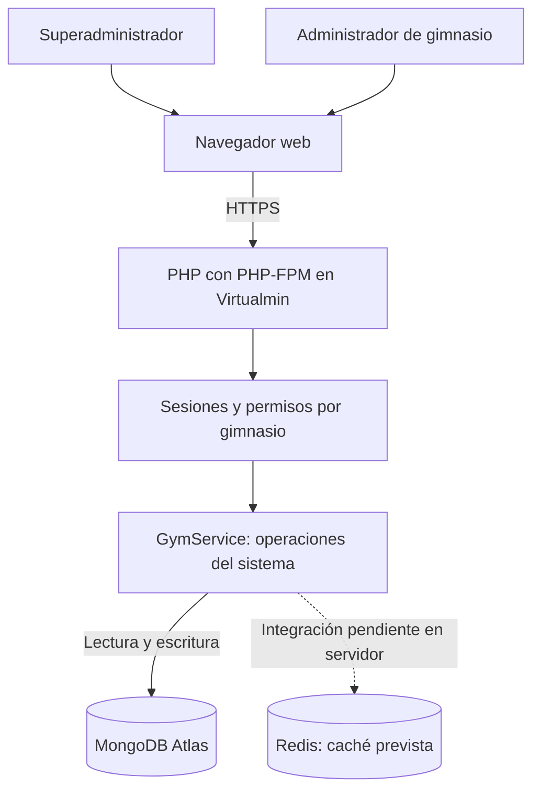

# Arquitectura v1 — GymFlow

**Seguimiento 1 · Grupo 01 · Actualización documental: 16 de octubre de 2026**

## Estado actual del despliegue

La aplicación publicada en https://grupo1.crnube.org/gymflow/ funciona con PHP en el servidor universitario administrado mediante Virtualmin y utiliza MongoDB Atlas para persistir los datos. La bitácora S1 documenta inicio de sesión, consulta del dashboard y registro de un socio desde la web hacia Atlas.

**Redis todavía no se utiliza en este despliegue.** Su habilitación y validación en Virtualmin siguen pendientes. El repositorio contiene código de integración para caché y configuración local con Redis; S1 registra pruebas locales de conexión y MISS/HIT reportadas por el equipo. Esas pruebas locales no acreditan que Redis esté activo en el servidor universitario.

## Diagrama del despliegue actual

La conexión punteada representa una integración pendiente, no un motor operativo en el despliegue actual.

## Responsabilidad de los datos

| Motor | Estado en servidor universitario | Datos y responsabilidad |
| --- | --- | --- |
| MongoDB Atlas | En uso; persistencia documentada en S1 | Seis colecciones: gimnasios, usuarios, socios, planes, membresias y pagos. Fuente definitiva de los datos. |
| Redis | Pendiente de habilitar y probar | Caché temporal prevista de indicadores del dashboard por gimnasio; no sustituye la persistencia de MongoDB. |

Las referencias entre documentos usan ObjectId y los importes se almacenan con Decimal128. Las consultas operativas se delimitan por gimnasioId. SQLite no forma parte del diseño seleccionado.

## Flujo actual y comportamiento previsto de la caché

Las altas y modificaciones se guardan en MongoDB Atlas. El código permite calcular los indicadores consultando MongoDB cuando no dispone de caché. Las pruebas de interfaz actuales no demuestran un HIT de Redis.

Cuando se habilite Redis, el código preparado contempla:

1. Consultar la clave de indicadores del gimnasio; un HIT reutiliza el resumen.
2. Ante MISS, expiración o indisponibilidad, calcular el resumen desde MongoDB.
3. Guardar temporalmente el resumen con TTL de 60 segundos por defecto.
4. Invalidar la clave después de confirmar cambios en MongoDB.

La invalidación y la recuperación ante fallos requieren pruebas documentadas. La ausencia de Redis en el servidor no equivale por sí sola a una prueba controlada de caída y recuperación.

## Entornos

- **Servidor universitario:** PHP 8.3 con PHP-FPM, Composer y extensión MongoDB; datos en Atlas, base `gymflow_pruebas`, según S1. Código y configuración privada fuera de la raíz web; entrada pública bajo `/gymflow/`. Redis pendiente.
- **Local:** Docker Compose configura PHP/Apache, MongoDB y Redis. La bitácora conserva resultados locales de conexión y caché reportados por el equipo. No deben confundirse con resultados del servidor.
- **Configuración Atlas:** URI en `.env` privado. El enunciado requiere AWS Oregon y acceso limitado a la IP autorizada del servidor; verificar la configuración efectiva sin publicar credenciales.

## Diseño de claves Redis pendiente de adaptar

El código actual usa `gymflow:s1:dashboard:<gimnasioId>` y valores JSON con TTL configurable. Si se utiliza Redis compartido del curso, el prefijo debe adaptarse antes de usarlo a `grupo1:`, por ejemplo `grupo1:gymflow:dashboard:<gimnasioId>`. Esta revisión documental no modifica ese código.

## Controles y límites

- El código incorpora hashes de contraseñas, sesiones, tokens CSRF y comprobación de referencias por gimnasio; la prueba de acceso cruzado entre gimnasios sigue pendiente.
- Se definen índices, incluidos índices únicos para evitar duplicados. La concurrencia de renovaciones requiere validación adicional.
- El plan incluye gestión de gimnasios, usuarios, socios, planes, membresías y pagos manuales. No incluye pagos bancarios automáticos, rutinas, agenda ni QR.
- `scripts/cache-benchmark.php` requiere Redis operativo. No hay resultados de rendimiento del servidor acreditados por esta revisión.
- Esta actualización corrige el estado del despliegue; no declara completados los requisitos posteriores de Redis, agregaciones MongoDB ni mediciones.

Ver [modelo de datos](../modelo-datos-v1.md), [plan de pruebas](../PRUEBAS.md) y [bitácora S1](../seguimientos/S1.md).
