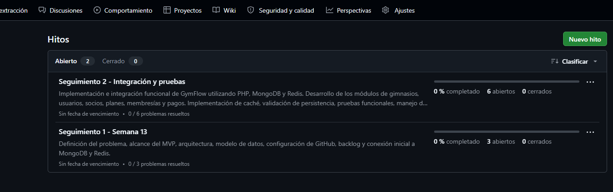
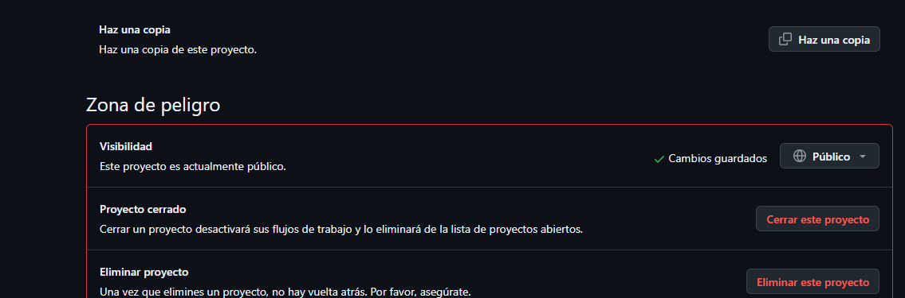
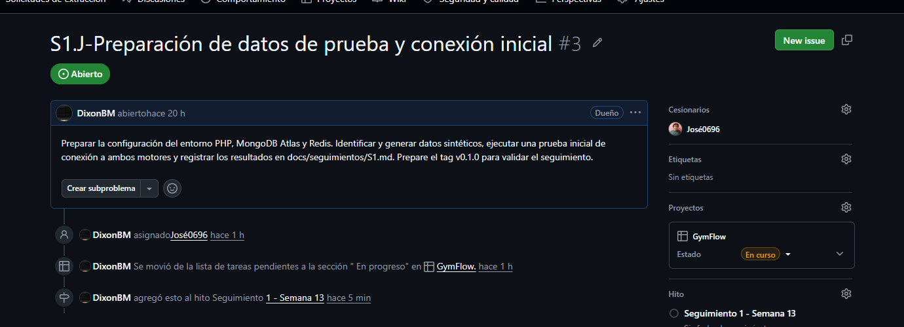
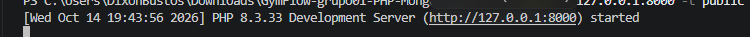
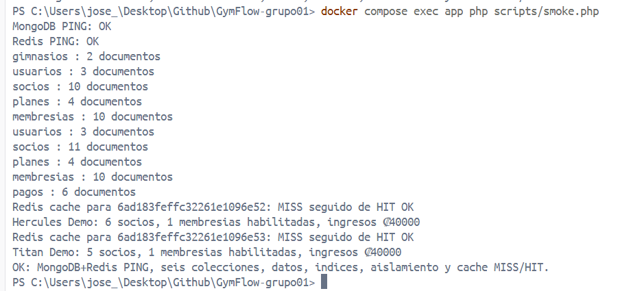
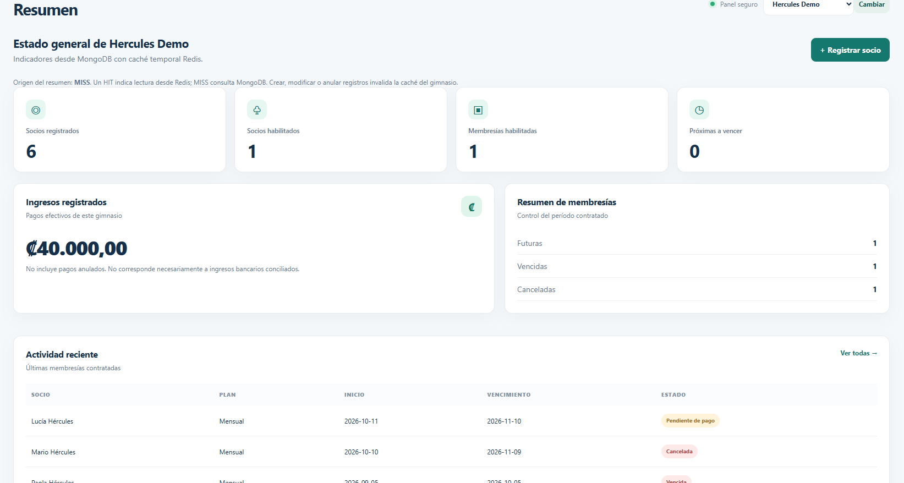
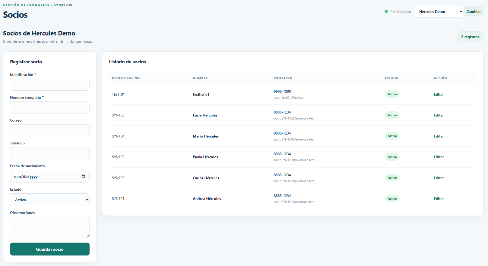

# Bitácora — Seguimiento 1 · Semana 13

**Proyecto:** GymFlow — Grupo 01 

**Curso:** Tópicos Avanzados de Bases de Datos, UNA 

**Fecha de última actualización documental:** 17 de octubre de 2026 (incluye pruebas posteriores al Seguimiento 1 y el despliegue automatizado) 

**Repositorio:** https://github.com/DixonBM/GymFlow-grupo01 

**Etiqueta publicada:** [`v0.1.0`](https://github.com/DixonBM/GymFlow-grupo01/tree/v0.1.0) 

**Commit de la etiqueta:** `67a5fb1` (publicación inicial de bitácora y evidencias)

## 1. Objetivo y alcance

Documentar el problema y el MVP de un SaaS para la administración de múltiples gimnasios; preparar repositorio, arquitectura, modelo de datos, backlog y datos sintéticos; y demostrar la conexión inicial de la aplicación con los motores elegidos. Esta bitácora distingue los resultados observados de las verificaciones todavía pendientes.

**Usuarios del MVP:** superadministrador y administrador de gimnasio. 

**Incluye:** gestión de gimnasios, cuentas administrativas, socios, planes, membresías, renovaciones, pagos manuales e indicadores. 

**Fuera del MVP:** rutinas, máquinas, acceso QR, agenda, pagos bancarios automáticos y aplicación móvil.

## 2. Arquitectura decidida

- **PHP 8.3 + HTML/CSS:** interfaz web, autenticación y lógica de negocio.

- **MongoDB:** persistencia de `gimnasios`, `usuarios`, `socios`, `planes`, `membresias` y `pagos`, con separación lógica por `gimnasioId`.

- **Redis:** caché temporal de indicadores, probada tanto en Docker local como en el servidor universitario. Desde PHP se verificó `Redis PING: OK` y `MISS → HIT`; TTL configurado en 60 segundos. MongoDB Atlas sigue siendo la fuente definitiva de los datos.

- **SQLite:** excluido por indicación del profesor.

- **Pruebas locales realizadas:** Docker Compose en la computadora de un integrante, con aplicación PHP, MongoDB 7.0 y Redis 7.4. Se verificaron conexiones reales con ambos motores y caché `MISS → HIT`.

- **Despliegue posterior ejecutado:** servidor de la universidad administrado mediante Webmin/Virtualmin (`grupo1.crnube.org`), PHP 8.3 con PHP-FPM, MongoDB Atlas (`gymflow_pruebas`) y Redis. Se verificó publicación web, inicio de sesión, persistencia real de socios y posterior actualización mediante GitHub Actions con aprobación.

- **Redis en Virtualmin:** servidor Redis operativo y accesible desde GymFlow; `redis-cli ping` devolvió `PONG`, el script `smoke.php` pasó y la pantalla **Conexión BD** mostró Redis conectado.

Documentos del diseño: [arquitectura v1](../arquitectura/arquitectura-v1.md) y [modelo de datos v1](../modelo-datos-v1.md). La implementación y su automatización se describen por separado en [el manual de despliegue](../despliegue/virtualmin-atlas.md) (incorporarlo al repositorio junto con esta actualización).

## 3. Registro de avances y evidencias reales

| Actividad | Resultado observado | Evidencia |
| --- | --- | --- |
| Repositorio GitHub | Repositorio público con licencia MIT, README y estructura del proyecto | [Repositorio](https://github.com/DixonBM/GymFlow-grupo01) |
| Backlog de trabajo | Nueve Issues organizados: tres vinculados al Seguimiento 1 y seis al Seguimiento 2 | [Hito S1](https://github.com/DixonBM/GymFlow-grupo01/milestone/1), [Hito S2](https://github.com/DixonBM/GymFlow-grupo01/milestone/2), [captura](../evidencias/01-hitos-seguimientos.png) |
| Visibilidad del tablero | GitHub Project `GymFlow` configurado como público | [Captura](../evidencias/02-github-project-publico.png) |
| Asignación de tareas | Issue #3 asignado a José Miguel y asociado al Project y al hito S1; falta confirmar individualmente las demás asignaciones | [Issue #3](https://github.com/DixonBM/GymFlow-grupo01/issues/3), [captura](../evidencias/03-issue3-responsable-hito.png) |
| Servidor PHP local | Inicio del servidor de desarrollo PHP 8.3.33 en `127.0.0.1:8000` | [Captura](../evidencias/04-servidor-php-iniciado.png) |
| Inicialización MongoDB local | `setup.php --seed` preparó seis colecciones, validaciones, índices y datos sintéticos | Registro de terminal y [prueba de conexión](../evidencias/05-conexion-mongodb-redis.png) |
| Conexión PHP ↔ MongoDB local | `MongoDB PING: OK` al ejecutar `smoke.php` | [Captura](../evidencias/05-conexion-mongodb-redis.png) |
| Conexión PHP ↔ Redis local | `Redis PING: OK` y caché `MISS → HIT` para ambos gimnasios | [Captura](../evidencias/05-conexion-mongodb-redis.png) |
| Acceso web local | Inicio de sesión y dashboard comprobados en la prueba local | [Captura](../evidencias/06-dashboard-gymflow.png) |
| Persistencia local | Registro de socio conservado al volver a consultar el sistema | [Captura](../evidencias/07-registro-socio.png) |
| Fuente de datos | Generador sintético `scripts/setup.php --seed` ejecutado satisfactoriamente | [Script](../../scripts/setup.php), [documentación](../../data/README.md) |
| Servidor Virtualmin | PHP 8.3.6, Composer y extensión MongoDB 2.5.2, dependencias instaladas por Composer | Verificaciones realizadas desde la terminal del usuario `grupo1` |
| Atlas para GymFlow | Se creó `gymflow_pruebas`, con seis colecciones e índices y 35 documentos sintéticos iniciales | Ejecución de `setup.php --seed` y consulta de conteos en Virtualmin |
| Aplicación publicada | Página de inicio de sesión y dashboard accesibles en `https://grupo1.crnube.org/gymflow/` | [Captura 08](../evidencias/08-gymflow-virtualmin-login.png) y [captura 09](../evidencias/09-gymflow-virtualmin-dashboard.png) |
| Persistencia web → Atlas | Registro inicial desde el navegador: 5 → 6 socios en Hércules y 10 → 11 socios en Atlas | [Capturas 10 a 12](../evidencias/10-gymflow-socio-registrado-virtualmin.png) (ver también 11 y 12) |
| Redis en Virtualmin | `redis-cli ping`: `PONG`; desde PHP, `Redis PING: OK`, MISS seguido de HIT y TTL de 60 s | [Evidencia final (captura 15)](../evidencias/15-verificacion-final-virtualmin-atlas-redis.png) — agregar al repositorio |
| Verificación final en Virtualmin | Seis colecciones con 44 documentos en total y pruebas `smoke.php` satisfactorias | [Evidencia final (captura 15)](../evidencias/15-verificacion-final-virtualmin-atlas-redis.png) — agregar al repositorio |
| GitHub Actions → Virtualmin | Despliegue exitoso tras `push` a `main`, validación PHP y aprobación en `gymflow-production`; commit `8de8c05` verificado en servidor | [Workflow](../../.github/workflows/deploy-virtualmin.yml) |

### Resultados de ejecución de MongoDB y Redis locales

Los siguientes resultados provienen de la ejecución real con Docker Compose comunicada por el integrante que clonó el repositorio:
```text
MongoDB PING: OK

Redis PING: OK

gimnasios : 2 documentos

usuarios : 3 documentos

socios : 10 documentos

planes : 4 documentos

membresias : 10 documentos

pagos : 6 documentos

Redis cache para [id de gimnasio]: MISS seguido de HIT OK

Hercules Demo: 5 socios, 1 membresias habilitadas, ingresos ₡40000

Redis cache para [id de gimnasio]: MISS seguido de HIT OK

Titan Demo: 5 socios, 1 membresias habilitadas, ingresos ₡40000

OK: MongoDB+Redis PING, seis colecciones, datos, indices, aislamiento y cache MISS/HIT.
```

**Alcance de esta prueba:** el script comprobó conexiones, datos, índices, consultas por gimnasio y comportamiento de caché `MISS/HIT`. No equivale a una prueba de caída de Redis, invalidación tras escrituras ni control HTTP de acceso cruzado entre gimnasios.

### Capturas incorporadas en el Seguimiento 1

**Hitos y nueve tareas:** 



**Project configurado como público:** 



**Issue #3, responsable e hito:** 



**Servidor de desarrollo PHP iniciado:** 



**Prueba local de conexión a MongoDB y Redis:** 



**Dashboard local:** 



**Socio registrado durante la prueba local:** 



### Evidencias de Virtualmin y Atlas

El equipo informó que las capturas 08 a 12 fueron subidas a GitHub. Revisar que sus enlaces sigan funcionando y que no contengan credenciales o datos personales sensibles:

| Archivo | Contenido |
| --- | --- |
| `08-gymflow-virtualmin-login.png` | Pantalla de inicio de sesión alojada en el dominio universitario |
| `09-gymflow-virtualmin-dashboard.png` | Dashboard autenticado de Hércules Demo |
| `10-gymflow-socio-registrado-virtualmin.png` | Mensaje de guardado correcto y seis socios listados en Hércules |
| `11-gymflow-persistencia-terminal.png` | Consulta en Virtualmin: `socios` pasó de 10 a 11 documentos |
| `12-gymflow-documento-mongodb-atlas.png` | Nuevo documento de socio con su `gimnasioId` en Atlas |

## 4. Estado frente a los nueve requisitos del seguimiento

| # | Requisito | Estado verificado hasta 17/10/2026 | Próximo paso |
| --- | --- | --- | --- |
| 1 | Repositorio público, licencia, `.gitignore`, carpetas | **Preparado y publicado** | Revisión final de secretos y estructura |
| 2 | Colaboradores y un commit individual por integrante | **Parcial** | Ya se registró un commit de José; comprobar también los demás integrantes |
| 3 | README con problema, usuarios y MVP | **Preparado y publicado** | Revisión final del equipo |
| 4 | Diagrama de arquitectura v1 | **Preparado y publicado** | Mantener coherencia con el entorno local y Atlas |
| 5 | Modelo de datos v1 | **Preparado; validadores e índices ejecutados** | Revisar los cambios posteriores del modelo |
| 6 | Backlog con responsables y un hito por seguimiento | **Muy avanzado** | Confirmar los responsables de los nueve Issues |
| 7 | Fuente de datos identificada | **Completada y ejecutada** | Conservar evidencia del generador sintético |
| 8 | «Hola mundo»: conexión real a cada motor | **Completada en Docker y en Virtualmin** con MongoDB Atlas + Redis | Conservar `smoke.php` y capturas finales como evidencia |
| 9 | Tag `v0.1.0` y bitácora | **Tag publicado; bitácora ampliada** | Publicar esta actualización en otro commit, sin mover el tag |

## 5. Registro de pruebas realizadas y pendientes

### Pruebas realizadas

- [x] MongoDB local operativo y `PING` exitoso.

- [x] Redis local operativo y `PING` exitoso.

- [x] PHP y dependencias funcionales en Docker Compose.

- [x] `php scripts/setup.php --seed` ejecutado sin errores en MongoDB local (`gymflow`).

- [x] `php scripts/smoke.php` validado contra MongoDB y Redis locales.

- [x] Seis colecciones, datos sintéticos e índices comprobados.

- [x] Caché Redis `MISS → HIT` observada en ambos gimnasios.

- [x] Inicio de sesión y registro de socio comprobados en el entorno local.

- [x] PHP, Composer y extensión MongoDB comprobados en Virtualmin.

- [x] Conexión desde GymFlow en Virtualmin a MongoDB Atlas mediante `PING`.

- [x] `setup.php --seed` ejecutado en Atlas sobre `gymflow_pruebas`, con 35 documentos sintéticos iniciales.

- [x] Página web publicada e inicio de sesión verificado en `https://grupo1.crnube.org/gymflow/`.

- [x] Socio guardado desde la interfaz web en Atlas; total de la colección `socios`: **10 → 11**.

- [x] Registro visualizado tanto en la lista web como en un documento de Atlas.
- [x] Redis instalado y disponible en Virtualmin (`redis-cli ping` → `PONG`).
- [x] Pantalla **Conexión BD** en PHP-FPM: MongoDB y Redis conectados; TTL Redis de 60 segundos.
- [x] `php scripts/smoke.php` ejecutado en Virtualmin con MongoDB Atlas + Redis; caché `MISS → HIT` correcta para Hércules y Titán.
- [x] Verificación final de 44 documentos en las seis colecciones de Atlas: 3 gimnasios, 4 usuarios, 12 socios, 5 planes, 12 membresías y 8 pagos.
- [x] GitHub Actions probado mediante ejecución manual y por evento `push` a `main`, ambas con validación de PHP y aprobación del entorno `gymflow-production`.
- [x] Commit `8de8c05` comprobado en Virtualmin después del despliegue automático; pruebas `smoke.php` satisfactorias.
- [x] Probar y documentar invalidación de caché tras modificar datos.
- [x] Verificar commits individuales de todos los integrantes en GitHub.

### Pruebas y evidencias pendientes

- [ ] Probar y documentar caída de Redis y continuidad de consulta a MongoDB.
- [ ] Verificar con una prueba HTTP específica la imposibilidad de acceder a otro gimnasio.
- [ ] Rotar credenciales expuestas y revisar el acceso a archivos privados antes de considerar producción pública.

**Observación:** las pruebas locales de Redis y las pruebas de Redis en Virtualmin son independientes; ambas fueron realizadas. El resultado de `smoke.php` no sustituye las pruebas todavía pendientes de caída del servicio, invalidación tras escrituras o control HTTP de permisos entre gimnasios.

## 6. Control de publicación

- **Rama principal:** `main`.

- **Tag publicado:** `v0.1.0`.

- **Commit al que apunta el tag:** `67a5fb1` — `docs: bitacora y evidencias del seguimiento 1`.

- **Enlace del tag:** https://github.com/DixonBM/GymFlow-grupo01/tree/v0.1.0

- **Evidencia posterior:** pruebas reales de Atlas, Redis y despliegue mediante GitHub Actions documentadas después de la publicación inicial de `v0.1.0`.

- **Despliegue automatizado confirmado:** commit `8de8c05` en el servidor, mediante workflow activado por `push` a `main` con aprobación.
- **Actualización documental:** publicar este `S1.md` y el manual técnico mediante un nuevo commit en `main`; **no mover ni sobrescribir `v0.1.0`**.

- **Seguridad:** no publicar las contraseñas generadas por `setup.php`, credenciales de Atlas ni contenido del `.env`.

## 7. Próximas actividades

1. Incorporar en GitHub la evidencia final `15-verificacion-final-virtualmin-atlas-redis.png` y el manual `docs/despliegue/virtualmin-atlas.md`, si aún no se han subido; confirmar enlaces y anonimizar las capturas.
2. Confirmar los commits individuales y responsables de todos los integrantes y cerrar el Issue #3 una vez revisadas sus evidencias.
3. Completar y documentar las pruebas de invalidación de caché, caída de Redis y control HTTP de separación por gimnasio, si el alcance del curso las exige.
4. Continuar el Seguimiento 2 (pruebas funcionales y de rendimiento), registrado por separado en `docs/PRUEBAS-S2.md`.
5. Rotar credenciales expuestas, comprobar permisos de archivos privados, respaldos y autorización del administrador del servidor para los despliegues automatizados.

## 8. Actualización posterior: despliegue en Virtualmin y MongoDB Atlas

Esta sección recoge trabajo efectuado **después de la preparación inicial del Seguimiento 1** y no modifica el contenido histórico de la etiqueta `v0.1.0`.

### 8.1 Entorno de despliegue

- **Dominio:** `https://grupo1.crnube.org/gymflow/`.

- **Servidor administrado con:** Webmin/Virtualmin, usuario `grupo1`.

- **Sistema operativo:** Ubuntu 24.04.4 LTS.

- **PHP:** 8.3.6 con PHP-FPM; extensión MongoDB 2.5.2.

- **Dependencias instaladas:** Composer, biblioteca `mongodb/mongodb` 2.5.0 y `predis/predis` 2.4.1.

- **Código original:** `/home/grupo1/apps/GymFlow-grupo01` (fuera de la raíz web).

- **Punto de entrada público:** `/home/grupo1/public_html/gymflow/index.php`, con recursos bajo `assets/` y acceso web restringido durante las pruebas.

- **Configuración privada:** archivo `.env` del proyecto, sin publicación en GitHub.

- **Persistencia:** clúster MongoDB Atlas existente, en la base independiente `gymflow_pruebas`.

- **Redis en este entorno:** instalado y operativo en el servidor, accesible desde PHP por `127.0.0.1:6379`; TTL de 60 segundos comprobado en la pantalla de conexión.

### 8.2 Preparación y conexión con Atlas

El repositorio se clonó en el área privada del usuario `grupo1` y se instalaron sus dependencias mediante Composer. Desde el servidor se confirmó el `PING` a Atlas con las clases del proyecto. Posteriormente se ejecutó `php scripts/setup.php --seed` sobre la base independiente `gymflow_pruebas` y se comprobó la creación de las seis colecciones, los índices y los datos sintéticos.

| Colección | Documentos iniciales |
| --- | ---: |
| `gimnasios` | 2 |
| `usuarios` | 3 |
| `socios` | 10 |
| `planes` | 4 |
| `membresias` | 10 |
| `pagos` | 6 |
| **Total** | **35** |

### 8.3 Publicación web y comprobación de persistencia

Se preparó una carpeta web separada en `public_html/gymflow`, mientras el código del sistema y sus dependencias permanecieron fuera de `public_html`. Se comprobó primero el bloqueo de acceso HTTP `403`; después se configuró un acceso restringido para las pruebas y se adaptó la carga de estilos para la subruta `/gymflow/`.

Se verificó la pantalla de inicio de sesión, el acceso a un dashboard administrativo y el registro de un socio desde el formulario web. La página informó que la operación se guardó correctamente en MongoDB y mostró **6 registros** para Hércules Demo frente a los **5 iniciales**. Una consulta ejecutada desde Virtualmin confirmó que el total de documentos en `gymflow_pruebas.socios` pasó de **10 a 11**. También se observó el documento creado en Atlas, asociado al gimnasio correspondiente mediante `gimnasioId`.

**Alcance de esta prueba inicial:** confirmó la escritura y lectura desde la aplicación web hacia Atlas. Redis en Virtualmin y el despliegue automatizado se comprobaron después, como se describe en la sección 10. Ninguna de estas pruebas equivale a una auditoría integral del sistema.

### 8.4 Evidencias de despliegue

Las capturas 08 a 12 documentan el acceso web y el registro inicial del socio en Atlas. La evidencia final del servidor, MongoDB y Redis corresponde al archivo `15-verificacion-final-virtualmin-atlas-redis.png`, que debe subirse a `docs/evidencias/` si todavía no está en GitHub. Revisar que no se publiquen datos personales ni claves.

### 8.5 Medidas de cierre del despliegue

- Redis y GitHub Actions ya fueron configurados y probados posteriormente; ver la sección 10.
- Incorporar el manual técnico reproducible en `docs/despliegue/virtualmin-atlas.md`.
- Documentar con evidencia una prueba de caída de Redis y la invalidación de caché después de una escritura, si se requiere como criterio de evaluación.
- Rotar y proteger las credenciales de Atlas y las cuentas de demostración expuestas durante la preparación; revisar permisos de acceso y respaldos.

## 9. Aclaración del estado de arquitectura — 16/10/2026

Al **16 de octubre de 2026**, el despliegue web usaba PHP y MongoDB Atlas y Redis aún se encontraba pendiente en Virtualmin. Esa era la situación documentada en la revisión de arquitectura realizada ese día y **no debe confundirse con el estado final del 17/10**, cuando Redis ya fue comprobado en el servidor.

Se había actualizado `docs/arquitectura/arquitectura-v1.md` para reflejar el estado de la implementación hasta esa fecha y se habían corregido los enlaces a las capturas 08 a 12. El documento de arquitectura también debe revisarse para reflejar el estado final con Redis integrado. Las pruebas funcionales de Seguimiento 2 se registran por separado en `docs/PRUEBAS-S2.md`.

## 10. Actualización final: Redis en Virtualmin y GitHub Actions — 17/10/2026

Esta sección registra **las pruebas posteriores**, sin alterar el contenido histórico de la etiqueta `v0.1.0` ni sustituir los resultados originales del Seguimiento 1.

### 10.1. Dos motores conectados desde el servidor

Se verificó `redis-cli ping` con respuesta `PONG`. En la pantalla **Conexión BD** de la aplicación se comprobó: **MongoDB conectado**, base `gymflow_pruebas`, **Redis conectado** y vida útil de la caché de **60 segundos**. MongoDB mantiene los datos definitivos; Redis conserva temporalmente los indicadores del panel.

En la terminal de Virtualmin se ejecutó:
```bash
cd /home/grupo1/apps/GymFlow-grupo01
php scripts/smoke.php
```

Resultados observados:
```text
MongoDB PING: OK
Redis PING: OK
gimnasios : 3 documentos
usuarios : 4 documentos
socios : 12 documentos
planes : 5 documentos
membresias : 12 documentos
pagos : 8 documentos
Redis cache para [Hércules]: MISS seguido de HIT OK
Hercules Demo: 7 socios, 2 membresias habilitadas, ingresos ₡60000
Redis cache para [Titán]: MISS seguido de HIT OK
Titan Demo: 5 socios, 1 membresias habilitadas, ingresos ₡40000
OK: MongoDB+Redis PING, seis colecciones, datos, indices, aislamiento y cache MISS/HIT.
```

| Colección | Documentos en la verificación final |
| --- | ---: |
| `gimnasios` | 3 |
| `usuarios` | 4 |
| `socios` | 12 |
| `planes` | 5 |
| `membresias` | 12 |
| `pagos` | 8 |
| **Total** | **44** |

Los **35 documentos de la carga inicial** de la sección 8.2 permanecen como referencia histórica. El total de **44** es el estado observado en la comprobación final; no representan la misma fecha ni la misma carga de datos.

### 10.2. Despliegue controlado y automático desde GitHub

Se preparó el script privado `/home/grupo1/bin/deploy-gymflow.sh` en Virtualmin y se configuró el workflow [`.github/workflows/deploy-virtualmin.yml`](../../.github/workflows/deploy-virtualmin.yml). Las credenciales de SSH se gestionan mediante secretos de GitHub y la configuración privada de Atlas permanece fuera del repositorio.

El workflow se ejecuta de dos maneras:

- `workflow_dispatch`: inicio manual desde la pestaña **Actions**.
- `push` a `main`: inicio automático después de un envío de cambios al repositorio.

En ambos casos se valida PHP; después el job de despliegue utiliza el entorno protegido `gymflow-production`, que solicita aprobación de un revisor antes de conectarse por SSH a Virtualmin. No es una publicación desatendida: **el disparo es automático, la aprobación sigue siendo manual**.

Se observó el estado **Success** en GitHub Actions para el despliegue activado por `push`. La terminal del servidor confirmó la versión desplegada:
```bash
git log -1 --oneline
# 8de8c05 ci: automatizar despliegue GymFlow desde main
```

Tras el despliegue, `php scripts/smoke.php` volvió a responder satisfactoriamente en MongoDB Atlas, Redis, colecciones y caché `MISS → HIT`. No se volvió a sembrar la base con `setup.php --seed`.

### 10.3. Evidencias y documentación reproducible

- [Captura final de commit, Atlas, Redis y caché](../evidencias/15-verificacion-final-virtualmin-atlas-redis.png) (**subirla si todavía no está en GitHub**).
- [Workflow de despliegue](../../.github/workflows/deploy-virtualmin.yml).
- [Manual reproducible de Virtualmin, Atlas, Redis y GitHub Actions](../despliegue/virtualmin-atlas.md) (**subirlo junto con la actualización documental**).
- Las ejecuciones de GitHub Actions con estado **Success** y los logs del job **Desplegar en Virtualmin** complementan la evidencia; conservar una captura si el profesor la solicita.

### 10.4. Límites de la comprobación y seguridad pendiente

Las pruebas demuestran conectividad, resultados de consultas, funcionamiento de caché y sincronización del commit de GitHub con el servidor. **No** sustituyen las pruebas de recuperación ante falla de Redis, invalidación de caché tras escrituras, autorización cruzada entre gimnasios, respaldo/restauración ni revisión de seguridad de producción.

Antes de ampliar el acceso, se recomienda rotar las contraseñas compartidas en capturas o conversaciones, revisar permisos del `.env`, definir respaldos y mantener la aprobación y autorización institucional para despliegues automatizados.

**Resultado de la actividad asignada:** documentados y probados el despliegue de GymFlow en Webmin/Virtualmin, la persistencia mediante MongoDB Atlas, Redis para caché y el despliegue desde GitHub Actions con aprobación.
